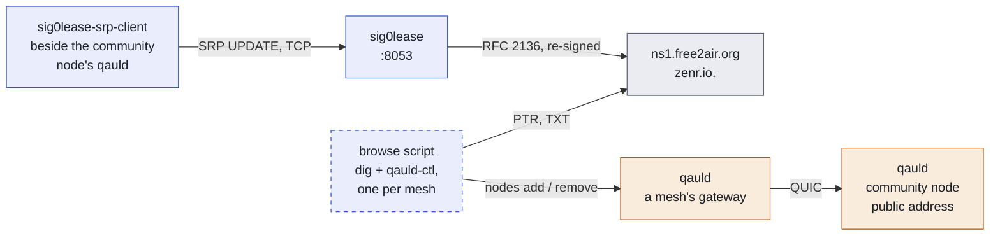

# Demo ideas not built yet

Demos and services this project could show beyond those in [demo.md](demo.md), each with what
exists, what is still to build, and what the room must provide. None of them runs yet.

## Discovery in the audience's own apps

D4 shows an audience Mac listing the zone's services in `dns-sd -B`, with no domain typed, once
the zone is its search domain. The next step is the applications people use.

- **Exists**: the `lb._dns-sd._udp` record the proxy publishes, which mDNSResponder looks for in
  each search domain (D4, `docs/dns-sd-records.md`); `srp-mdns-proxy`, built from source, which
  advertises our registrations on the local network (`docs/siglease_rfc9665.md` §12, Direction 2).
- **To try**: Finder and a print dialog on a Mac, and an iPhone.
- **To build**: Android browses only multicast DNS, so it needs a bridge from the zone to the
  local network, which does not exist.
- **The room**: our own access point, or control of the venue's DHCP, to hand out the domain as
  the search domain.

## A map of live locations

Rooms, stands or people on a map, each a LOC record at its owner's name, which the owner keeps
refreshing; a point disappears when its owner stops.

- **Exists**: sig0namectl's map page (`demo/map` in the sig0namectl repository), which draws LOC
  records. `update_handler` accepts LOC: only the types in `blacklisted_types` are refused. A
  name's LOC record can be given as an RFC 9664 name's `records:` in an agent template, or with
  `sig0lease-client name -record`.
- **To check**: publishing the map's `_loclist._udp` list through the proxy, in place of
  sig0namectl's scripts.
- **The room**: internet for the phones showing the map; phones with GPS for moving points
  (Termux on Android).

## Two qaul meshes joined through the event domain

qaul is an offline messenger: devices form a mesh over the LAN (its own libp2p mDNS) and
Bluetooth LE. Its Internet module links meshes through peers listed by IP address, as libp2p
multiaddresses, in its `config.yaml`; nothing in it uses DNS, as libqaul builds libp2p without
its `dns` feature. Here a community node announces itself in the event's SRP domain, and a
script adds it to each mesh's daemon. Blue is this project's code, dashed where still to build,
orange qaul's, and grey the DNS infrastructure.



Two meshes that cannot see each other, say phones with the qaul app on the venue's Wi-Fi and a
laptop on a phone's hotspot, each with a `qauld` gateway. When the community node starts
publishing, each gateway's script adds it, and the users of one mesh appear in the other: qaul's
router sends its routing table to every neighbour, over LAN and Internet alike
(`docs/qaul/rust/routing.md` in qaul), so chat crosses. When the publisher stops, its instance
goes at the end of its lease, and the scripts remove the peer from each gateway's list.

- **Exists**: the proxy and `sig0lease-srp-client`, whose service-type check `_qaul._udp`
  passes, and whose `-txt` splits at the first colon only, so IPv6 multiaddresses survive. qaul
  2.0.0-rc.9's release packages, nothing compiled: apps for Android, macOS, Windows and Linux
  (snap); `qauld` and `qauld-ctl` as `.deb` (amd64, arm64, armhf); the Docker image
  `qaulnet/qauld`. `qauld-ctl node info` prints the node's ID, its libp2p PeerId;
  `qauld-ctl connections nodes add` and `nodes remove` change a running daemon's peers.
- **To build**: the browse script, our code with `dig` and `qauld-ctl`: list
  `_qaul._udp.<domain>`, read each instance's TXT, add new peers and remove those gone.
- **To check**: qaul tracks reconnections by address string (`rust/libqaul/src/lib.rs`, at qaul
  commit 74b5114); test that an address ending in `/p2p/<PeerId>` reconnects. With that suffix,
  libp2p refuses a node holding another key, so a forged entry costs one failed dial.
- **Optional, in qaul**: with libp2p's `dns` feature and `.with_dns()`, a peer could be
  `/dnsaddr/<node>.<domain>`, its addresses at `_dnsaddr.<node>` written through RFC 9664, as an
  IPFS node's are (D3).
- **The room**: a community node with a public address and its UDP port open, with
  `internet.do_listen: true` in its `config.yaml` (off by default; `qauld --port` sets only the
  listen addresses), publishing the port the host exposes (qaul's `docker-compose.yml` maps 8778
  to 9229); internet for each gateway, while the rest of a mesh needs only its LAN.

What it would run, by hand:

1. On the community node, beside `qauld`, find its PeerId and publish it, refreshing until
   Ctrl-C:

   ```bash
   qauld-ctl node info
   sig0lease-srp-client -domain=srp.dev.zenr.io. -server=<proxy>:8053 \
     -host=qaul-node -addr=<public IPv4> -instance=node1:_qaul._udp:<port> \
     -txt='node1:dnsaddr=/ip4/<public IPv4>/udp/<port>/quic-v1/p2p/<PeerId>' \
     -lease=60 -key-lease=300 -keystore=./qaul-identity -k=15
   ```

2. On each mesh's gateway, what the browse script would do:

   ```bash
   dig +short PTR _qaul._udp.srp.dev.zenr.io.
   dig +short TXT node1._qaul._udp.srp.dev.zenr.io.
   qauld-ctl connections nodes add \
     --address /ip4/<public IPv4>/udp/<port>/quic-v1/p2p/<PeerId> --name node1
   ```

## Services no demo shows yet

`sig0lease-agent` registers a service by its type: a preset (`sig0lease-agent types` lists
them), or a type a template defines. These would need a type of their own, or more:

| Service | Records | Through | What it needs |
|---|---|---|---|
| Meetings, notes | `_https._tcp` with subtypes such as `_jitsi`, `_notes` | SRP | A template's own types; Jitsi, HedgeDoc or Etherpad to register. Subtypes let a browser filter by kind. |
| Matrix | SRV `_matrix-fed._tcp.<server>` | RFC 9664 | A name's service, as XMPP's in D5, with a type of the template's own; a homeserver. |
| ActivityPub | an `_activitypub._tcp` instance, TXT `acct=@user@host` | SRP | The `activitypub` preset exists; `_activitypub._tcp` is our own type, not registered with IANA, so only our tools browse it. |
| WireGuard VPN | `_wg._udp` server, `_wgpeer._udp` client request, `_wgcfg._udp` per-client config, linked by subtypes | SRP | The handshake over DNS: still in development. |
| qaul node | a `_qaul._udp` instance, TXT `dnsaddr=…/p2p/<PeerId>` | SRP | The browse script above; `_qaul._udp` would be our own type. |
| Location | LOC at the owner's name | RFC 9664 | The map above. |
