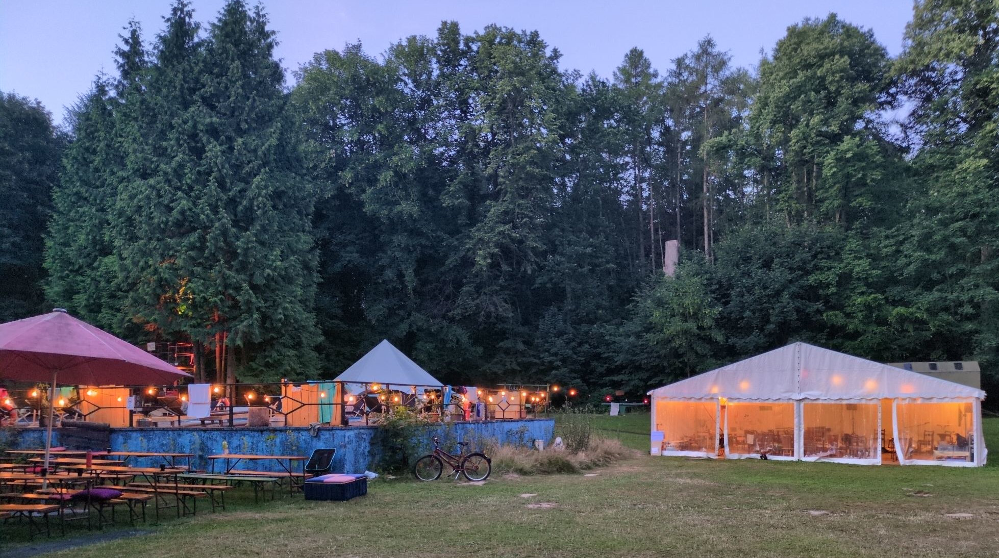
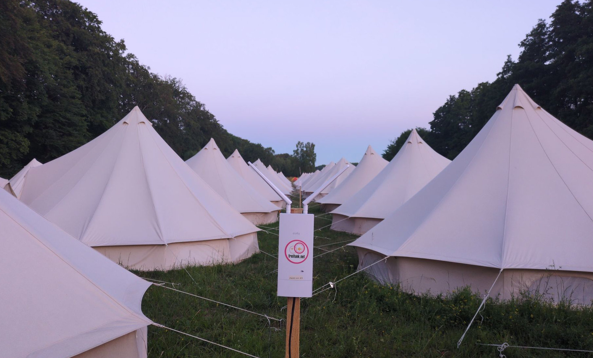

+++
title = 'sig0lease Workshop at DwebCamp 2026 in Berlin'
layout = 'posts'
date = 2026-07-11T09:30:00+02:00
draft = false
featured_image = ""
toc = false
+++

sig0lease was present at [DwebCamp 2026 in Berlin](https://dwebcamp.org/berlin-2026/) and had an interactive workshop at the “Decentralized Hardware & Community Network” track to  explaining and demonstrate sig0lease. The workshop table was filled to the last chair with people eager to learn about and test sig0lease.

Most attendees were either producers of P2P libraries and software or community network activists. The interest was very high to learn about this new possibility of service discovery in large local networks, where there was no dynamic standardized way to do service discovery before.

Participants were excited about the demo and were highly interested in integrating it into their projects. The discursive format of workshop was filled with questions and discussions until the last minute.

A good demonstration ground for sig0lease was the Freifunk network at camp site, to demonstrate and experience user discovery in a large community network.

Thanks a lot to DWebCamp and the “Decentralized Hardware & Community Network” track for hosting us. We are continuing working with the interested projects to help them integrating it.

<https://talx.dod.ngo/dwebcamp-2026/talk/NTYGHS/>