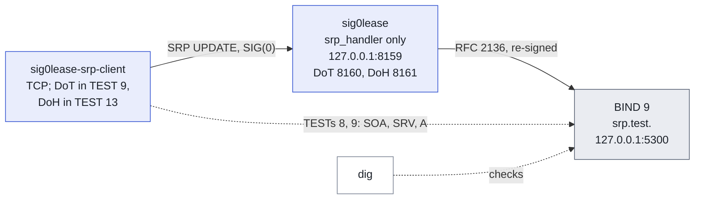
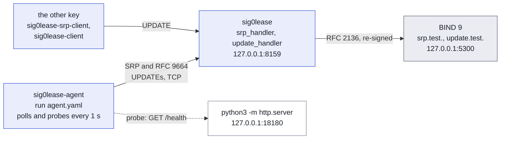
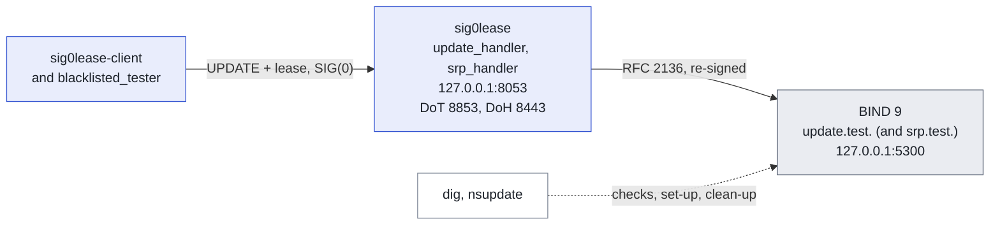
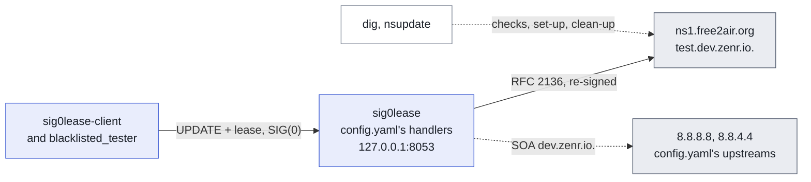
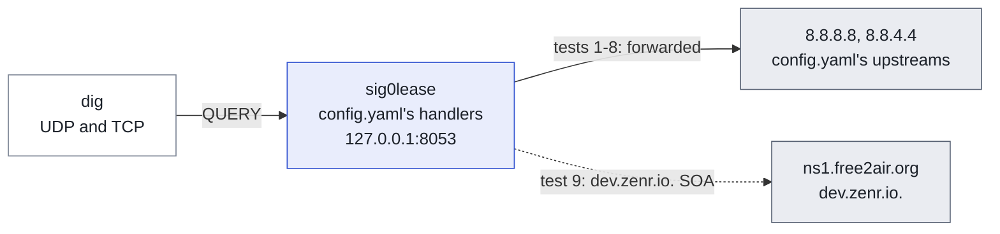
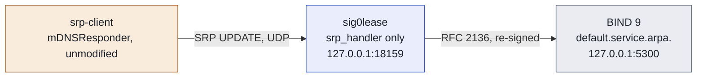
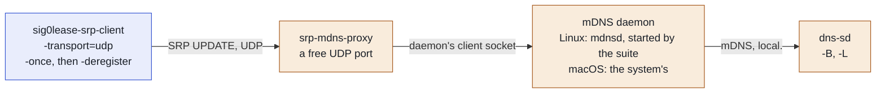
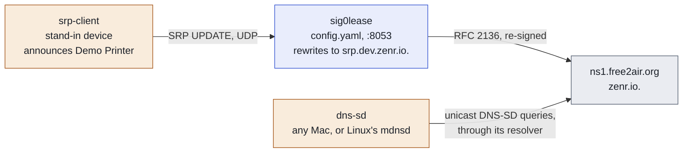
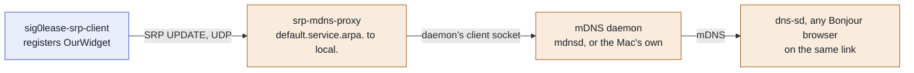

# Test suite

Orchestration scripts live directly in `tests/`; shared helpers live in `tests/lib/`. Every
`test_*.sh` script follows the same shape: `source tests/lib/common.sh` (and whichever other
`lib/*.sh` files it needs), then `run|cleanup` as its only CLI surface. See `lib/common.sh`'s
own header comment for the "no `set -e` in library files, `return` not `exit`" convention
those files follow.

## Suites at a glance

What a suite tests is in its script's header comment and in its `TEST` lines; how its
processes talk to each other is drawn below ("Suite by suite").

| Suite | Run with, from `main/` | Needs | Checked with |
|---|---|---|---|
| Unit tests | `CLIENT_KEYSTORE_DIR=$PWD/keystore/client make test-unit` | nothing external; `pkg/sig0` reads the client keys | `go test -race ./...`, after `go fmt` and `go vet`; network code against in-process fakes and servers on `127.0.0.1:0` |
| `test_srp.sh` | `make test-srp` | `named`, `dig`, `openssl` | `dig` at BIND 9 |
| `test_agent.sh` | `make test-agent` | as `test_srp.sh`, and `python3`; Prosody for AGENT-TEST 10 and kubo for AGENT-TEST 11, each skipped without | `dig` at BIND 9, the agent's log |
| `test_mdnsresponder_interop.sh` | `make test-mdnsresponder-interop` | `named`, the `../mDNSResponder` build ("External checkouts"); Linux: root; macOS: `mbedtls@3` | `dig` at BIND 9, `dns-sd` |
| `test_update.sh`, local | `make test-update-local` | `named`, `nsupdate`, `dnssec-keygen`; no network | `dig` and `nsupdate` at BIND 9, the lease-store dump, the Extended DNS Error's reason |
| `test_update.sh`, live | `CLIENT_KEYSTORE_DIR=$PWD/keystore/client make test-update` | internet, `nsupdate`; writes the real zone | `dig @ns1.free2air.org`, the lease-store dump |
| `test_forward.sh` | `./tests/test_forward.sh run` | internet | each query gets an answer; with `forward` off, REFUSED with Extended DNS Error 20, and the handlers' zone answered by its authoritative server |

`test_srp.sh`, `test_agent.sh`, the interop suite and `make test-update-local` all start BIND 9
on `127.0.0.1:5300` (`BIND9_PORT`): run them one after the other. The proxy ports are
`PROXY_PORT`, `PROXY_TLS_PORT` and `PROXY_DOH_PORT` for `test_update.sh` and
`test_forward.sh`, `SRP_PROXY_PORT`, `SRP_PROXY_TLS_PORT` and `SRP_PROXY_DOH_PORT` for
`test_srp.sh` and `test_agent.sh`, and `D1_PROXY_PORT` for the interop suite. `test_agent.sh`
also listens on `AGENT_HTTP_PORT` (18180, the probed web server), `XMPP_A_PORT` and
`XMPP_B_PORT` (15269, 25269) and the `IPFS_*_PORT`s of its three kubo nodes (14001 to 35001).

### Suite by suite

Each diagram runs from the requester, through the proxy, to the server the proxy forwards to;
dashed arrows are lookups and checks beside that path. Results are checked at the
authoritative server, never through the proxy. Blue is this project's code, grey the DNS
infrastructure, which knows nothing about SRP, and white the other programs a suite runs. The
interop suite's three directions are drawn under "mDNSResponder" below.

**`test_srp.sh`**: our client, our registrar, a local BIND 9. TESTs 8 and 9 find the registrar
first, asking BIND 9 through `-resolver` for the SOA of `srp.test.`, the SRV of
`_dnssd-srp._tcp.srp.test.` (`_dnssd-srp-tls._tcp` in TEST 9) and the A of `proxy.srp.test.`.



**`test_agent.sh`**: our agent on a template the suite writes and rewrites while it runs, the
same proxy and BIND 9 as `test_srp.sh` (`lib/srp.sh`), with `update_handler` too for the
template's RFC 9664 names. The other key, which holds a name the agent wants, is
`sig0lease-srp-client`'s for a host and `sig0lease-client`'s for a name. AGENT-TESTs 10 and 11
add two Prosody servers and three kubo nodes, each found through the records the agent
publishes.



**`test_update.sh`, local**: RFC 9664 leases against a local BIND 9, through a copy of
`config.yaml` localized to it (below), over UDP, or TCP, DoT or DoH with `PROXY_PROTOCOL`.
`nsupdate` writes BIND 9 directly for set-up and clean-up.



**`test_update.sh`, live**: the same tests on the real zone, through `config.yaml`'s handlers.
The proxy finds `ns1.free2air.org` from the SOA of `dev.zenr.io.`, asked of its upstreams: the
only suite that exercises that lookup.



**`test_forward.sh`**: plain queries. Tests 1 to 8 run with `server.forward` on, so the proxy
forwards them to its upstreams. Test 9 turns it off: a query outside the handlers' zones is
refused, and one for `dev.zenr.io.` is answered from that zone's authoritative server.



## Zones and keys

| Zone | Authoritative | Used by | Proxy signs with |
|---|---|---|---|
| `srp.test.` | BIND 9, local | `test_srp.sh`, `test_agent.sh`; `srp_handler` in the local `test_update.sh` run | `keystore-srp-bind9/` |
| `update.test.` | BIND 9, local | the local `test_update.sh` run, names under `test.update.test.`; `test_agent.sh`'s RFC 9664 names | `keystore-update-bind9/` |
| `default.service.arpa.` | BIND 9, local | interop Directions 1 and 3: Apple's `srp-client` has this domain built in | `keystore-srp-bind9-default-arpa/` |
| `test.dev.zenr.io.`, in `zenr.io.` | `ns1.free2air.org` | the live `test_update.sh` run | `../keystore/server/Kdev.zenr.io.+015+35317` |

In the local runs each handler gets its own zone and key, so the two never share either. The
clients' keys:
`test_srp.sh` and interop Direction 2 make throwaway keys in scratch keystores; `sig0lease-agent`
makes its own, one per host and name, in its template's keystore (`test_agent.sh`, interop
Direction 3); the local `test_update.sh` run makes two ED25519 keys with `dnssec-keygen`; the
live run uses `CLIENT_KEYSTORE_DIR`.

## The suites

`test_srp.sh` is self-contained: real proxy process, real client (`cmd/sig0lease-srp-client`), a local
disposable BIND 9 (`lib/bind9.sh`, zone `srp.test.`) — nothing outside this repo required
beyond `go`, `named`/`named-checkconf`, `dig`, and `openssl` (for the throwaway certificate of
the proxy's DNS-over-TLS listener, which TEST 9 registers through). So is `test_agent.sh`
(`make test-agent`), which runs `sig0lease-agent` on templates it writes, against the same proxy
and BIND 9 (`lib/srp.sh`, shared with `test_srp.sh`), with `python3`'s `http.server` as the
probed service: run registers, a stopped service is withdrawn and comes back, template edits
apply and an invalid one is ignored, a held name is renamed and the rename kept across a
restart, and stopping deregisters. And so is `test_update.sh` with `AUTH_BACKEND=local` (below).

On a Mac whose firewall is in stealth mode, the first try of alice's kubo node, started again in
`test_agent.sh`'s AGENT-TEST 11, to connect to the community node (`connect_to_community` after
`start_kubo alice`) can fail:

```
  * [/ip4/<the Mac's address>/tcp/24001] failed to negotiate security protocol: tls: received unexpected handshake message of type *tls.clientHelloMsg when waiting for *tls.serverHelloMsg
```

- The community node knows alice's addresses from their first connection, and dials alice
  while alice's node is down, after the test pins alice's folder on it. Stealth mode
  (`net.inet.tcp.blackhole=2`) leaves a connection to a closed port on the Mac's network
  address unanswered instead of refused, so that dial is still pending when alice's node is
  back.
- kubo dials from its own listening port. When alice's node then dials the community node,
  the two attempts use the same two ports and become one TCP connection (a simultaneous open),
  on which both nodes start TLS as the client. Both dials fail at once, and none is left
  pending.

On Linux a closed port refuses at once, so the community node's dial is over before alice's
node is back. There are two ways around it:

1. Implemented: `connect_to_community` tries again every second, for up to `CHANGE_TIMEOUT`
   seconds, as a member's node does in D3, where the community node is its peering peer. The
   next try connects, as no dial is pending any more: on a Mac, the second try, a second after
   the first. A failed try is not hidden: the suite prints it with the try that connected
   (`alice reached the community node at try 2, ...; before: ...`), or, if none does, with the
   failure.
2. Not needed with 1, and kept as an alternative: run the suite with kubo dialing from a port
   of its own for each connection, so that the two attempts cannot become one (the kubo nodes
   inherit the environment):
   ```bash
   LIBP2P_TCP_REUSEPORT=false make test-agent
   ```

`test_update.sh` (by default) and `test_forward.sh` run against the **real DNS**, not a local
BIND 9. Both start the proxy from a copy of `main/config.yaml` (only the listen address,
`server.diagnostics` and the minimum leases are rewritten), so they also use its lease-store
files under `data/`.

- `test_update.sh` updates the live `test.dev.zenr.io.` records: the proxy finds the
  authoritative server for `dev.zenr.io.` via an SOA lookup and signs with
  `keystore/server/Kdev.zenr.io.+015+35317`. The suite checks results with `dig` against
  `AUTH_SERVER` (default `ns1.free2air.org`) and adds/deletes some records there directly with
  `nsupdate` (needs a current BIND `nsupdate` with ED25519 support). Needs
  `CLIENT_KEYSTORE_DIR` (see the Makefile's `test-update` target), holding two keys at
  `test.dev.zenr.io.` with different key tags: `CLIENT_KEY_NAME` and `WRONG_CLIENT_KEY_NAME`,
  the never-registered signer of TEST 3 (the run fails early if either is elsewhere; make one
  with `dnssec-keygen -K <dir> -a ED25519 -n HOST -T KEY test.dev.zenr.io.`). Overridable via
  env: `AUTH_SERVER`, `PROXY_ADDR`/`PROXY_PORT`, `PROXY_PROTOCOL`, `PROXY_LAUNCH` (below),
  `CLIENT_KEY_NAME`, `WRONG_CLIENT_KEY_NAME`, `RR_TYPES` and the lease times. The config file,
  the zones and the proxy key are fixed. `PROXY_PROTOCOL` is `udp` (default), `tcp`, or
  `tls`: with `tls` the client sends DNS-over-TLS to `PROXY_ADDR:PROXY_TLS_PORT` (default
  8853), and the proxy's config gets that listener turned on, with a throwaway certificate
  (needs `openssl`).

  With `AUTH_BACKEND=local` (`make test-update-local`) the same suite runs against the local
  BIND 9 of `lib/bind9.sh` instead. The scratch copy of `config.yaml` is then localized for
  that deployment (`localize_lease_config`): only what names a server, zone, key or file is
  replaced, so every other setting, including ones `config.yaml` gains later, carries over.
  The upstream resolvers become the local BIND 9; the RFC 9664 handler serves its own zone
  `update.test.` (key in `keystore-update-bind9/`), and the client registers under
  `test.update.test.`; `srp_handler` runs ahead of it, as in `config.yaml`, on `srp.test.`
  (key in `keystore-srp-bind9/`). Each handler reaches the BIND 9 through its static
  `upstream` (the commented-out `# upstream:` line of its section, turned on) and keeps its
  leases in a file in its run directory. The run fails if `config.yaml` has a handler section this doesn't
  localize, or if any zone, key, file or upstream server `config.yaml` names is left, so
  nothing outside the run is touched. (SOA discovery is therefore only exercised by the live
  run.) The two client keys are generated for the run with `dnssec-keygen`, so
  `CLIENT_KEYSTORE_DIR` is not needed (and is ignored), nor is network access. At the end, as
  in `test_srp.sh`, any request `named`
  rejected other than a SIG(0) quota refusal fails the run, even if a retry later hid it from
  the suite's own checks.
- `test_forward.sh` needs internet access: it resolves public names (google.com, gmail.com,
  ...) through the proxy's configured upstream resolvers.

## The proxy under test, and debugging it

Every suite writes its proxy's config, and the files the config names (DoT certificate, lease
files in local runs), into its own directory under `/tmp/sig0lease-debug/`, named after the
Makefile target: `update`, `update-local`, `srp`, `agent`, `mdnsresponder-interop`, and
`forward` for `test_forward.sh`; `agent`'s also holds the agent's template, keystore and log. The directory is emptied at the start of each run and kept after it, so its
`config.yaml` and `proxy.log` can be read once the run is over. Each config turns on
`server.diagnostics`, so the suites check refusals by the reason in the reply's Extended DNS
Error (RFC 8914), which `sig0lease-client` and `sig0lease-srp-client` print after the status
line (`EDE 18 (Prohibited): ...`), and can query the lease-store dump. Nothing may listen on a
suite's proxy port when it starts.

`PROXY_LAUNCH` says who starts that proxy. `auto`, the default, has the script start it from
`bin/<os>/sig0lease`, with its log in `proxy.log`. `manual` has the script write the config
and wait (up to `PROXY_LAUNCH_TIMEOUT` seconds, default 600) for you to start the proxy with
it, e.g. in a debugger with breakpoints set; it then checks that the process listening on the
port was started with that config, and leaves it running at the end. With a proxy still
listening when a run starts, it waits for you to stop it first, so its last save can't land in
the new run's files. `test_srp.sh`'s TEST 11 restarts the proxy with a changed config: with
`manual` it asks you to restart it. The proxy's output then goes wherever you started it.

```sh
PROXY_LAUNCH=manual make test-update-local
```

VS Code launch configurations for it, for `.vscode/launch.json` (`cwd` must be `main/`, since
`config.yaml`'s relative paths start there; with `main/`'s parent open as the workspace, as
here, prefix `main/` to `program` and `cwd`):

```json
{
    "name": "sig0lease: test-update-local",
    "type": "go",
    "request": "launch",
    "mode": "debug",
    "program": "${workspaceFolder}/cmd/sig0lease",
    "cwd": "${workspaceFolder}",
    "args": ["/tmp/sig0lease-debug/update-local/config.yaml"]
}
```

and the same with `update`, `srp`, `agent`, `mdnsresponder-interop` or `forward` in place of
`update-local` in `name` and `args`.

## External checkouts

Two scripts additionally depend on a **sibling checkout, outside this repo, checked out
deliberately rather than vendored or auto-cloned**: real reference implementations of SRP
from other projects, used because a real independent implementation is a much stronger
correctness signal than anything this repo could construct on its own. Both live as siblings
of `main/` (i.e. `../mDNSResponder`, `../openthread` relative to this file), overridable via
`MDNSRESPONDER_DIR` / `OPENTHREAD_DIR` env vars if you keep them somewhere else.

They're deliberately **not** vendored (no git submodule, no copy into this repo): both are
large, independently-maintained upstream trees: vendoring would bloat this repo, duplicate
their own git history, and drift from upstream fixes. The commit each was actually tested
against is pinned below instead — clone fresh and check out that commit (or a later one; SRP
is stable in both projects) rather than assuming `main`/`master` behaves identically forever.

### mDNSResponder (`ServiceRegistration/`) — required for `test_mdnsresponder_interop.sh`

Apple's own SRP client (`srp-client`) and registrar (`srp-mdns-proxy`) reference
implementation, plus an mDNS daemon and its browse tool (`dns-sd`). `tests/test_mdnsresponder_interop.sh`
runs the real, unmodified binaries against our own registrar and client, in the three
directions drawn below ("The three directions"). `tests/lib/mdnsresponder.sh`'s `build_mdnsresponder`
builds them automatically the first time the interop script runs (subsequent runs reuse the
existing build), into `ServiceRegistration/build/<os>/` (`linux` or `darwin`), so one checkout
can serve both a Linux machine and a Mac.

- **Linux:** the daemon is mDNSResponder's own `mdnsd`, with `dns-sd`, built from `mDNSPosix/`
  and `Clients/`. The script must run as root: it starts `mdnsd`, which creates
  `/var/run/mdnsd` and binds UDP 5353, and it refuses to start if another mDNS daemon already
  listens on that socket.
- **macOS:** the daemon is the system's mDNSResponder (`/var/run/mDNSResponder`), with
  `/usr/bin/dns-sd`, as in the Mac demo. Nothing to start and no root needed. While Direction 2
  runs, `srp-mdns-proxy`'s DNS proxy also listens on UDP port 53 of every interface: macOS lets
  any process bind it, and Linux's build stops the DNS proxy before, for want of a TLS key.

Either way, Directions 2 and 3 advertise their test services (`Gizmo`, `Mirror Demo`) on the
local network while they run. Direction 3's is mirrored by `sig0lease-agent`, from a
template with one `mdns` mirror.

```
git clone https://github.com/apple-oss-distributions/mDNSResponder.git ../mDNSResponder
cd ../mDNSResponder && git checkout -b rel/mDNSResponder-2881 --track origin/rel/mDNSResponder-2881
git apply ../main/tests/mdnsresponder-build.patch   # tested at mDNSResponder-2881.120.11
```

Needs `mbedtls`: on Linux its dev libraries (`apt-get install libmbedtls-dev`), on macOS
Homebrew's version 3 (`brew install mbedtls@3`; version 4 dropped APIs the code uses). The
open-source snapshot does not build or run on Linux or macOS as published;
`tests/mdnsresponder-build.patch` holds the local fixes, none of which touches SRP message
handling:

- `srp-log.c`: defines `srp_log_ref_check`/`srp_log_ref_final`, which `srp.h` declares and
  `srp-mdns-proxy.c` calls but nothing defines.
- `ServiceRegistration/Makefile`: links `srp-clientstub.o` (new in 2881.40.18, never added to
  the POSIX Makefile) in place of `dnssd_clientstub.o`, and builds the Linux target with
  `-DSRP_FEATURE_REPLICATION=0`: `srp-replication.c` uses symbols that are only in Apple's
  internal tree. The suites never use registrar-to-registrar replication.
- `ServiceRegistration/Makefile`, again: adds the macOS target `os=x-mbedtls`. It is Apple's
  `os=x` with mbedtls in place of the Security framework, and the same
  `-DSRP_FEATURE_REPLICATION=0`. With the Security framework, `srp-client` keeps its key in
  one login-keychain item that every run shares. With mbedtls it keeps it in a file in its
  working directory, as on Linux, which the suite relies on to give each test a fresh key.
- `srp.h` (macOS): with clang, `FILE_TRIM` returned an invalid pointer for a file name without
  a `/`, which is what a Makefile build compiles, and `srp-mdns-proxy` crashed at its first
  log line about an allocation. It now returns the name as it is.
- `ioloop.c` (macOS): a listener created with no address never got its `sa_len`, so `bind()`
  failed with EINVAL and `srp-mdns-proxy` had no SRP listener. Linux has no `sa_len`.
- `srp-dnssd.h`: includes `srp-clientstub.h`, which declares the two functions it calls.
- `mDNSShared/uds_daemon.c`: one AWDL-only expression that refers to stripped code becomes
  `mDNSfalse`, as the file's two other split-AWDL flags already are. Needed for `mdnsd`.

The suite runs `make os=<linux|x-mbedtls> BUILDDIR=build/<os> OBJDIR=objects/<os> setup
build/<os>/srp-client build/<os>/srp-mdns-proxy` from `ServiceRegistration/`. A plain `make`
there still builds Apple's default target into `build/`. `srp-dns-proxy` does **not** build
in this snapshot (unrelated drift, several call sites don't match current signatures
elsewhere in the tree) — source-level reference only, not exercised by any test here.

#### The three directions

In the diagrams, blue is this project's code, orange Apple's mDNSResponder, and grey the DNS
infrastructure, which knows nothing about SRP. Each arrow is a message, from its sender.

**Direction 1: Apple's requester against our registrar.**



`srp-client` has `default.service.arpa.` built in, so the proxy serves that zone (`docs/siglease_rfc9665.md` §9). It runs
from a fresh directory each time, as it keeps its key file in the current directory, and never
exits: the suite waits for `Register Reply for <host>: 0` in its log, then stops it. It
registers a host with an instance (A, KEY, SRV and PTR at BIND 9; it asks for a LEASE of
14400 s and must log that it refreshes on the 7200 s the proxy grants), a host alone
(`--host-only`), and the three subtype variants (`--test-subtypes`, `--test-diff-subtypes`,
`--test-renew-subtypes`, whose old subtype PTR must go). It shows that the proxy accepts
messages from an implementation it was not written against, ECDSA P-256 signatures and KEY
flags 513 included.

**Direction 2: our requester against Apple's registrar.**



The registration must get NOERROR, `srp-mdns-proxy`'s log must say the update `validates`, and
`dns-sd` must find `Gizmo._http._tcp.local.` at `d2-register.local.:8080` with its TXT
`path=/d2`. The deregistration (LEASE 0) must get NOERROR, the log must confirm the instance's
delete, and the last event `dns-sd -B` reports for Gizmo must be `Rmv`. This registrar publishes
to mDNS, not to a zone, so the check is `dns-sd`, not `dig`.

**Direction 3: Apple's daemon as the source; our agent and registrar publish.**

```mermaid
flowchart LR
  app["dns-sd -P<br/>Mirror Demo on<br/>d3-host.local. 192.0.2.33"]:::theirs
  daemon["mDNS daemon<br/>Linux: mdnsd<br/>macOS: the system's"]:::theirs
  agent["sig0lease-agent<br/>mdns mirror of<br/>d3-host.local."]:::ours
  proxy["sig0lease<br/>Direction 1's proxy<br/>127.0.0.1:18159"]:::ours
  bind["BIND 9<br/>default.service.arpa."]:::infra
  app -- "daemon's client socket" --> daemon
  daemon -- "browse, resolve,<br/>getaddrinfo" --> agent
  agent -- "SRP UPDATE, TCP" --> proxy
  proxy -- "RFC 2136, re-signed" --> bind
  classDef ours fill:#e9edfc,stroke:#3454d1,color:#1b2028
  classDef theirs fill:#f9ecdc,stroke:#a5571a,color:#1b2028
  classDef infra fill:#eaecf1,stroke:#566072,color:#1b2028
```



The agent's template has no hosts of its own, only an `mdns` mirror of `d3-host.local.`'s
`_http._tcp`. What `dns-sd -P` advertises on the local network must reach the zone, every name
moved from `local.` to `default.service.arpa.`: `Mirror\032Demo._http._tcp` SRV `0 0 8080
d3-host.default.service.arpa.`, A `192.0.2.33`, TXT `path=/d3` and the type's PTR. When
`dns-sd -P` stops, the daemon tells its browsers the instance is gone, and that is all it does:
it knows nothing of the zone. The mirror, one of those browsers, deregisters the host, the
proxy deletes the SRV and A, and the agent logs `mdns mirror: d3-host: deregistered "Mirror
Demo" _http._tcp; names kept for its key`. Advertised again, then stopped with SIGTERM, the agent
deregisters before it exits 0. The checks poll for up to 20 s: the mirror waits about 1 s for
changes to settle, and each registration starts after the client's initial delay of 0 to 3 s.
The mirror reads the daemon over the client socket every Bonjour application uses, so on a Mac
it reads the system daemon unchanged, and nothing but our code is compiled: that is demo D2
(`docs/demo.md`).

#### By hand

Directions 1 and 2 can also be run by hand, the first on the real zone. Both need
`../mDNSResponder` built, as `make test-mdnsresponder-interop` does (above).

**Direction 1 on the real zone**: Apple's `srp-client` stands in for a device with its own SRP
client, such as a Thread accessory, and registers through the proxy; another machine browses it.
macOS ships no SRP client: a Mac's own services reach the zone through `sig0lease-agent`'s
`mdns` mirror (demo D2).



1. Start the proxy, from `main/`, with `config.yaml` as it is: `srp_handler` serves
   `srp.dev.zenr.io.` with `rewrite_default_service_arpa: true` and `allow_udp: true`.

   ```bash
   make build
   ./bin/$(uname -s | tr A-Z a-z)/sig0lease
   ```

2. Start the device, from an empty directory, the same one every time (below):

   ```bash
   SRPC="$PWD/../mDNSResponder/ServiceRegistration/build/$(uname -s | tr A-Z a-z)/srp-client"
   mkdir -p /tmp/srpc && cd /tmp/srpc
   "$SRPC" --server <proxy-ip>%8053 \
     --host-name demo-printer \
     --instance-name "Demo Printer" \
     --service-type _http._tcp --service-port 8080 \
     --txt-data 0a706174683d2f64656d6f \
     --lease-time 120
   ```

   `--txt-data` is the TXT record in wire format, as hex: `0a` (length 10), then `path=/demo`.
   The device publishes its own interface addresses and refreshes until Ctrl-C.

3. Find it from another machine; `dns-sd` comes with macOS:

   ```bash
   dns-sd -B _http._tcp srp.dev.zenr.io.
   dns-sd -L "Demo Printer" _http._tcp srp.dev.zenr.io.
   dns-sd -G v4 demo-printer.srp.dev.zenr.io
   ```

   On Linux, build and start mDNSResponder's own daemon and tool first:

   ```bash
   cd ../mDNSResponder/mDNSPosix
   make os=linux Daemon Clients
   sudo ./build/prod/mdnsd
   export LD_LIBRARY_PATH=$PWD/build/prod
   ../Clients/build/dns-sd -B _http._tcp srp.dev.zenr.io.
   ```

What `dns-sd -B` and `dns-sd -L` print, with the time of each line in place of `hh:mm:ss.mmm`:

```
Timestamp     A/R    Flags  if Domain               Service Type         Instance Name
hh:mm:ss.mmm  Add        2   0 srp.dev.zenr.io.     _http._tcp.          Demo Printer

hh:mm:ss.mmm  Demo\032Printer._http._tcp.srp.dev.zenr.io. can be reached at demo-printer.srp.dev.zenr.io.:8080 (interface 0)
 path=/demo
```

`Flags` is a bit mask, in hex: 2 is `kDNSServiceFlagsAdd` (an `Rmv` line lacks it), 1 is
`kDNSServiceFlagsMoreComing` (another result follows at once). `if` is the interface index: 0
for an answer from unicast DNS, the network interface's index for one from multicast DNS. `\032`
is a space. `dns-sd -G v4` prints the addresses the device published. The names are the
device's, moved into `srp.dev.zenr.io.`. Stop the device and, after its lease, the proxy deletes
the records and `dns-sd -B` prints `Rmv`, later where a resolver still caches them.

- `srp-client` refreshes on the lease the proxy grants, so a lower `max_rr_lease_sec` works as
  well as a lower `--lease-time`. It reads the granted lease only from a reply whose one record
  is the OPT RR, as the proxy's is.
- `srp-client` always asks for a 7-day KEY lease, and only a running proxy removes the KEYs. For
  a short run, lower `max_key_lease_sec`, and `max_rr_lease_sec` to no more than it: the proxy
  refuses to start with a data-lease limit above the KEY-lease limit. 300 s and 120 s worked;
  the device sends its KEY again at every refresh.
- With a new key file the names still belong to the old KEY: the proxy answers `YXDOMAIN`, and
  `srp-client` retries under names with a space appended, which BIND refuses (`docs/siglease_rfc9665.md` §11, "Host
  names the authoritative server refuses"). Restart it with a `--host-name` and an `--instance-name`
  no other key holds.
- Linux's `mdnsd` asks the system's resolver, which must answer PTR and SRV for `zenr.io.`; one
  that did not was replaced by 8.8.8.8.

**Direction 2 on the local network**: our client registers, and `srp-mdns-proxy` advertises it as
a `.local` service to every Bonjour browser on the link.



1. On Linux, start `mdnsd` (Direction 1 by hand, step 3); on macOS the system's daemon
   advertises. Start `srp-mdns-proxy`, and find the UDP port it listens on:

   ```bash
   ../mDNSResponder/ServiceRegistration/build/$(uname -s | tr A-Z a-z)/srp-mdns-proxy --log-stderr &
   ss -ulnp | grep srp-mdns-proxy      # Linux
   lsof -nP -a -p $! -iUDP            # macOS: the port that is not 53
   ```

2. Register, with that port:

   ```bash
   make build-client
   ./bin/$(uname -s | tr A-Z a-z)/sig0lease-srp-client \
     -domain=default.service.arpa. -host=ourdemo -addr=192.0.2.77 \
     -transport=udp -server=127.0.0.1:<port> \
     -instance=OurWidget:_http._tcp:8080 -txt=OurWidget:path=/ours \
     -keystore=./keystore/client -k=13 -once
   ```

3. Browse and resolve it:

   ```bash
   dns-sd -B _http._tcp local.
   dns-sd -L OurWidget _http._tcp local.
   ```

   ```
   Timestamp     A/R    Flags  if Domain               Service Type         Instance Name
   hh:mm:ss.mmm  Add        2   2 local.               _http._tcp.          OurWidget

   hh:mm:ss.mmm  OurWidget._http._tcp.local. can be reached at ourdemo.local.:8080 (interface 2)
    path=/ours
   ```

   Found over multicast DNS, so `if` is the index of the network interface the answer came in
   on, which varies by machine, not 0 as for a zone.

4. Withdraw it: step 2's command with `-deregister` in place of `-once`.

### OpenThread — only needed to *regenerate* a fixture, not for routine test runs

OpenThread's SRP client/server is the RFC's other credited independent implementation. It is
**not** used for network-level interop (its simulation platform has no host-reachable
network interface — see docs/siglease_rfc9665.md's OpenThread interop section for the full empirical
finding) and there is no automated script that touches this checkout. Instead, one real
signed SRP registration message was extracted from it once and is now a hardcoded fixture in
`pkg/srp/srp_test.go` (`TestValidate_RealOpenThreadCapture`) and
`pkg/sig0/ecdsa_test.go` (`TestECDSAP256KnownAnswerFromOpenThread`) — routine `go test ./...`
needs no OpenThread checkout at all.

You'd only need the checkout to redo or refresh that extraction (e.g. if `pkg/srp`'s message
shape assumptions ever need re-validating against a fresh OpenThread build). If so:

```
git clone https://github.com/openthread/openthread.git ../openthread
cd ../openthread && git checkout 67437ed96469acfd865a9437e7edfa6c3f5f0a60   # commit actually tested
git submodule update --init --recursive --depth 1        # mbedtls, and its own nested submodule
```

Then, temporarily, add a hex-dump of the outgoing message right before the client's send
call in `src/core/net/srp_client.cpp` (search for `mSocket.SendTo` — `info.mMessage` at that
point holds the complete signed update, identical to what goes out on the wire), build and
run the `nexus` test platform's own two-node client/server test:

```
top_builddir=build/nexus ./tests/nexus/build.sh
./build/nexus/tests/nexus/nexus_srp_client_change_lease
```

Copy the captured hex out of stdout, `git checkout src/core/net/srp_client.cpp` to revert
the instrumentation (leave the checkout pristine — it's a third-party tree, not part of this
repo), and update the two `capturedOpenThreadHex`/fixture constants above with the new bytes.

`tests/nexus/build.sh` is OpenThread's own authoritative build entry point for this platform
(not `script/cmake-build`, which has no `nexus` preset) — it configures via
`-DOT_PROJECT_CONFIG=tests/nexus/openthread-core-nexus-config.h`, not a hand-assembled cmake
flag list; reusing the `simulation` platform's own flags directly on `nexus` fails with
unrelated missing-symbol errors.
